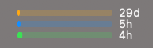
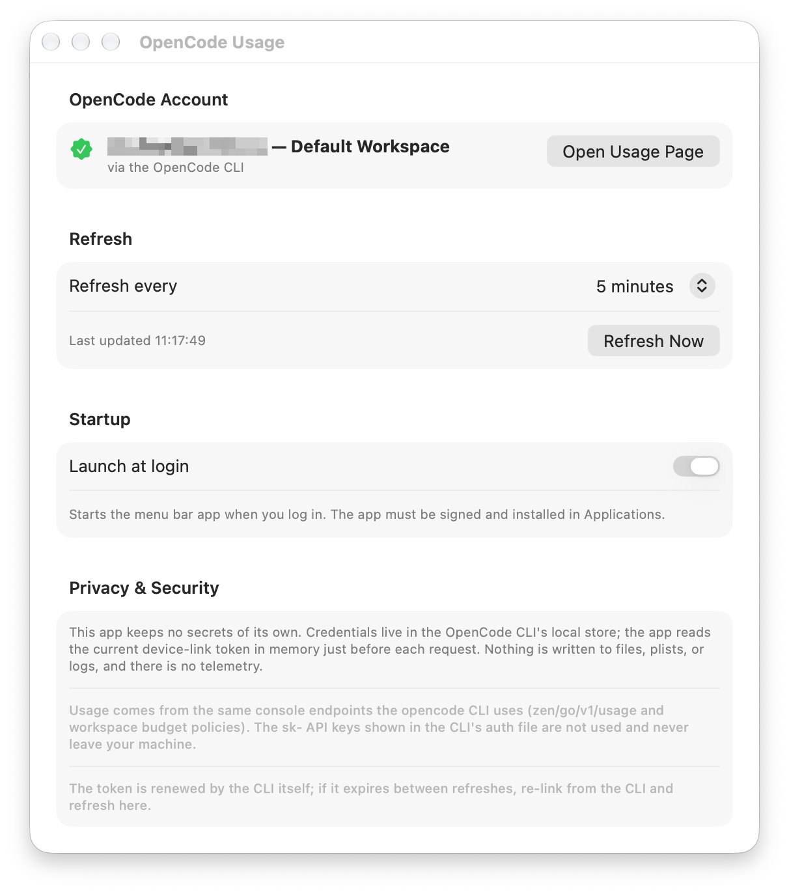

# OpenCode Usage (OpencodeUsageTracker)

A native macOS menu bar app that shows your OpenCode Go usage with no Node.js
dependencies and no browser cookie. Sits in the menu bar as three compact bars
(Rolling / Weekly / Monthly usage windows), with a full menu.





Architecture (shared with DeepSeekUsageTracker):

- `Sources/App` — `@MainActor ObservableObject` model, app lifecycle, launch-at-login
- `Sources/Core` — CLI credential store + console usage API client
- `Sources/UI` — status item (three-bar view), menu, settings window
- `Tests/` — unit tests
- `docs/` — README screenshots (status bar, settings window)

## How it works

1. Reads the device-linked workspace credential from the **OpenCode CLI**
   (`~/.local/share/opencode/opencode.db`, `auth.json` fallback). Secrets are
   never copied — the app reads the current token in memory on every refresh,
   so CLI-side renewals are picked up automatically.
2. Calls the same console endpoints the CLI uses:
   - `GET {console-origin}/zen/go/v1/usage` → Rolling/Weekly/Monthly windows
     (percent + reset time) authenticated with `Authorization: Bearer` +
     `x-opencode-org-id`.
   - `GET {console}/api/policies/current-budgets` → spend budgets
     (authenticated with `Authorization: Bearer` + `x-org-id`).
3. Shows the three windows as bars in the status item and a per-window menu
   with reset times, budgets, and the last-updated stamp.

Note: the plain `sk-…` API keys in the CLI's `auth.json` are rejected by these
endpoints — a device link (`opencode` → `/connect`) is required.

## Setup

1. Install the [OpenCode CLI](https://opencode.ai) and link the device
   (run `opencode`, then use `/connect`).
2. Build and run with Xcode, or:

   ```
   xcodebuild -project OpencodeUsageTracker.xcodeproj -scheme OpencodeUsageTracker build
   ```

3. If the CLI has several workspaces, pick one in Settings.

## Updates

The app updates itself with [Sparkle 2](https://sparkle-project.org). Each
release publishes an `appcast.xml` beside the DMG; the app reads `SUFeedURL`
from `Info.plist` (`…/releases/latest/download/appcast.xml`), verifies the
EdDSA signature against `SUPublicEDKey`, and installs silently. Checks run
daily, and "Check for Updates…" lives in the menu.

- The signing key is a single Ed25519 key for all okric apps, stored in the
  login keychain under account `okric`. Restore it with
  `generate_keys --account okric -f <backup-file>`; the exported key belongs
  in a password manager. Losing it means existing installs can never be
  updated again.
- `Scripts/notarize.sh` bumps `MARKETING_VERSION` and `CURRENT_PROJECT_VERSION`
  (Sparkle compares the build number), re-signs the embedded Sparkle framework
  inside-out, and generates + uploads `appcast.xml`.
- Releases before the first Sparkle build have no updater; install that one
  manually from the DMG.

## Tests

```
xcodebuild -project OpencodeUsageTracker.xcodeproj -scheme OpencodeUsageTracker test
```

## Icon

`Scripts/make-icon.swift` renders the app icon (three usage bars on a dark
tile) straight into the asset catalog:

```
swift Scripts/make-icon.swift Sources/Icon.xcassets/AppIcon.appiconset
```
